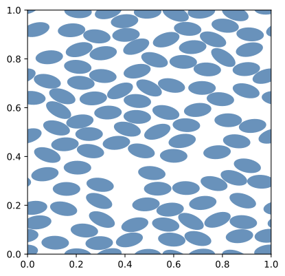

.. _example_MD_Ellipses:
=================================
MD Ellipses
=================================

Input file
==========

To run this example, open a termial inside the ``GMMD`` repository and run the following command:

.. code-block:: console

    python3 -m geommicgen 'geommicgen/resources/examples/MD_Ellipses.mgsim'

In order for you to run any other file of your making, you just need to run the command with the location of your input file.

The full text of the input file is:

.. literalinclude:: ../../../../geommicgen/resources/examples/MD_Ellipses.mgsim
    :language: xml

Phases
======

The microstructure has two phases:

- a matrix phase, described by::

    Phase 0
    Phase_Type 1

- and an ellipse phase, described by::

    Phase 1
    Phase_Type 3
    n 100
    vf 0.5
    angle_distribution normal
        angle_mean 0
        angle_sigma 0.2
    ratio 2

The microstructure contains 100 ellipses with a volume fraction of 0.5. The ratio between the major and minor axis of the ellipses is 2, and their orientation angle follows a normal distribution with mean 0 and standard deviation 0.2.

Generation Method
=================

This example uses a molecular dynamics simulation to generate the microstructure.

In a nutshell, the molecular dynamics simulation starts by placing all the particles randomly in the simulation box. Then, in each step, it computes the repulsion forces between particles based on their overlap and solves the equations of motion to obtain the particles' velocities. The process continues until a legal configuration is reached, that is, a configuration where there is no overlap.

In each step, the program checks for intersection for every particle pair. This process can be rather time consuming, expecially for a large number of particles, resulting in O(N²) complexity, where N is the number of particles. Thus, speed up schemes were introduced. In a simplified manner, the speed up scheme allows for the program to not check intersection of a pair of particles that can be shown to not intersect apriori, achieving O(N) complexity.
In this example, Verlet speed up scheme is used, with a Verlet factor of 1.1.

The maximum number of iterations is 100.

Output files
============
After running the command, a folder named ``MD_Ellipses`` will be created in the same directory as the input file
A .pdf file of the final microstructure is created.

    Final configuration of the microstructure.

.. include:: /_includes/next_button.inc
