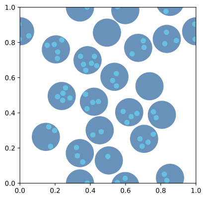

====================
MD Inner Outer Disks
====================

Input file
==========

The file for this tutorial is located in the ``geommicgen/resources/examples/`` directory and is named ``MD_Inner_Outer_Disks.mgsim``. To run this example, open a terminal inside the ``GMMD`` repository and run the following command:

.. code-block:: console

    geommicgen 'geommicgen/resources/examples/MD_Inner_Outer_Disks.yaml'

The full text of the input file is:

.. literalinclude:: ../../../../geommicgen/resources/examples/MD_Inner_Outer_Disks.yaml
    :language: yaml

Phases
======

This example shows how to place the particles of one phase inside the particles of another phase. The phase that contains the particles is called the **outer phase** and the phase placed inside it is called the **inner phase**.

The microstructure has three phases:

- a matrix phase, described by::

    Phase 0
    Phase_Type 1

- an outer phase of disks, described by::

    Phase 1
    Phase_Type 2
    r 0.08
    vf 0.4

- and an inner phase of smaller disks, described by::

    Phase 2
    Phase_Type 2
    inner_phase True
    outer_phase 1
    r 0.015
    vf 0.04

The outer disks have a radius of 0.08 and a volume fraction of 0.4. The inner disks have a radius of 0.015 and a volume fraction of 0.04.

Two keywords turn a phase into an inner phase:

- ``inner_phase True`` marks the phase as an inner phase;
- ``outer_phase 1`` gives the ``phase_id`` of the phase whose particles will contain it.

The volume fraction of the inner phase is relative to the whole RVE, not to the outer phase. It must therefore be smaller than the volume fraction of the outer phase.

Generation Method
=================

This example uses a molecular dynamics simulation to generate the microstructure. The maximum number of iterations is set to 100, a minimum distance of 0.005 between particles is imposed and the speed up scheme used is Verlet.

The generation is done in two steps:

1. The molecular dynamics simulation is run with the outer phase only. The inner phase does not take part in it.
2. After the simulation, the inner particles are placed inside the outer particles using RSA.

The maximum number of steps of the inner phase placement can be set with ``Inner_Phase_Max_Step``. It is not specified in this example, so the default of 200 is used. See :ref:`input_file_options` for more details.

Output files
============

After running the command, a folder named ``MD_Inner_Outer_Disks`` will be created in the same directory as the input file. This folder contains all the output data related to the microstructure generation.
A .pdf file of the final microstructure is created with the line ``final_config True`` in the input file.

In this example, 57 inner disks are distributed among 20 outer disks. Each outer disk contains a different number of inner disks, and some may contain none, since the inner disks are assigned to the outer disks at random.

    Final configuration of the microstructure. The inner disks (light blue) are placed inside the outer disks (dark blue).

.. include:: ../../_includes/previous_button.inc

.. include:: ../../_includes/next_button.inc
