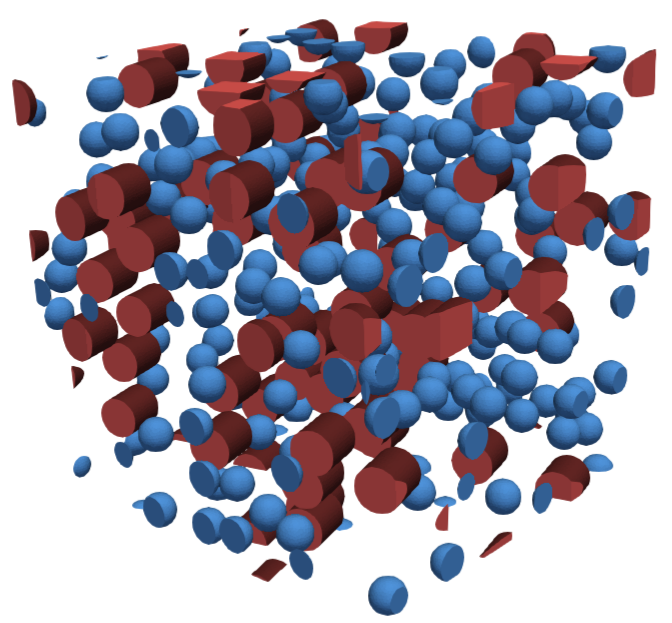

========================
MD Spheres and Cylinders
========================

Input file
==========

The file for this tutorial is located in the ``geommicgen/resources/examples/`` directory and is named ``MD_sphere_cylinder.mgsim``. To run this example, open a terminal inside the ``GMMD`` repository and run the following command:

.. code-block:: console

    python3 -m geommicgen 'geommicgen/resources/examples/MD_sphere_cylinder.mgsim'

The full text of the input file is:

.. literalinclude:: ../../../../geommicgen/resources/examples/MD_sphere_cylinder.mgsim
    :language: xml

Phases
======

The microstructure has three phases:

- a matrix phase, described by::

    Phase 0
    Phase_Type 1

- a sphere phase, described by::

    Phase 1
    Phase_Type 4
    vf 0.05
    r 0.04

- and a cylinder phase, described by::

    Phase 2
    Phase_Type 7
    r_cyl 0.05
    length 0.1
    azimuth_angle 0
    polar_angle 0.2618
    vf 0.05

The microstructure is generated in a cubic RVE of unit dimensions. The spheres all have a radius of 0.04 and a volume fraction of 0.05.
The cylinders also have a volume fraction of 0.05, with a radius of 0.05 and a length of 0.1. Their orientation is defined by the ``azimuth_angle`` and ``polar_angle`` descriptors, which set the direction of the cylinder axis and are given in radians. Here, the azimuth angle is 0 and the polar angle is 0.2618 rad (15°), so the cylinder axis is tilted 15° from the z-axis towards the x-axis. Since these descriptors take fixed values, all cylinders share the same orientation.

Generation Method
=================

This example uses a molecular dynamics simulation to generate the microstructure. The maximum number of iterations is 200 and the speed up scheme used is Verlet, with a Verlet factor of 1.1. A minimum distance of 0.002 between particles is imposed and, with ``Max_Residue_Per_Particle 0``, no overlap between particles is allowed in the final configuration.

Output files
============
After running the command, a folder named ``MD_sphere_cylinder`` will be created in the same directory as the input file. This folder contains all the output data related to the microstructure generation.
A .vtk file of the final microstructure is created with the line ``final_config True`` in the input file. This file can be opened in a 3D visualization tool, such as ParaView.

.. Since ``Save_History True`` is set in the input file, the positions of all particles throughout the complete motion are saved, instead of only the initial and final configurations (see :ref:`md_motion_analysis`).

    Final configuration of the microstructure.

.. include:: /_includes/previous_button.inc

.. include:: /_includes/next_button.inc
