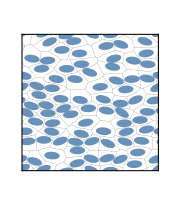

=================================
Voronoi analysis
=================================

This software aims to generate microstructures for random heterogenoeus materials. The microstructure can be simulated using finite element analysis. The Vonoroi analysis is here used to access if the microstructure is random or if there is any clustering or order.

This example focuses, then, on the Voronoi analysis. The microstructure descriptors and the generation method are the same as in :ref:`example_MD_Ellipses`.

Input file
==========

To run this example, open a termial inside the ``GMMD`` repository and run the following command:

.. code-block:: console

    python3 -m geommicgen 'geommicgen/resources/examples/MD_Ellipses_voronoi.mgsim'

The full text of the input file is:

.. literalinclude:: ../../../../geommicgen/resources/examples/MD_Ellipses_voronoi.mgsim
    :language: xml

Voronoi diagrams
================

Consider a set of points in a plane, called seeds. The Voronoi diagram divides the plane into cells, one for each seed. Every location inside a cell is closer to that cell's seed than to any other seed. For point seeds, every cell is a convex polygon. We can construct the Voronoi diagram using as seeds the center of mass of a particle. However, if the particles are not equally sized disks (or spheres in 3D), the cells in the Voroni diagram may intersect the particles. This is what happens when we use ``voronoi_type standard``, which is the default option.

.. list-table::
    :widths: 50 50
    :class: borderless

    * - .. figure:: voronoi_example.svg
            :width: 100%
            :alt: Voronoi example

            Example of voronoi diagram with its seeds

      - .. figure:: voronoi_standard.svg
            :width: 100%
            :alt: Voronoi example

            Standard Voronoi diagram for this example

One way to avoid this problem is to build the diagram from the surfaces of the particles instead of their centres of mass. This is called the set Voronoi diagram. Its cells can be non-convex and can have curved edges. This tutorial uses the set Voronoi diagram, selected with the line ``voronoi_type set``. The line ``n_surf_points 25`` sets the number of points sampled on the surface of each ellipse to build the diagram.

Output files
============
After running the command, a folder named ``MD_Ellipses_voronoi`` will be created in the same directory as the input file
A .pdf file of the final microstructure is created along with several files regarding the Voronoi analysis.

The line ``plot_imts True`` plots the Voronoi diagram including the values of the Minkowski structure metrics corresponding to each cell along with its histograms.

    Voronoi diagram of the final microstructure configuration.

Detecting clustering and order
------------------------------

The plots of the Minkowski structure metrics can be used to qualitatively detect unwanted order and clustering in the microstructure.

In short, the structure metric :math:`q_s` measures :math:`s`-fold symmetry and not symmetries of a higher order. Take, for example, a regular hexagon. It has 6-fold symmetry, so :math:`q_6 = 1` and :math:`q_s = 0` for :math:`s = 1, \dots, 5`, regardless of its size or orientation.

A hexagonal arrangement of particles therefore shows up as a group of neighbouring Voronoi cells with :math:`q_6` close to 1. More generally, a region of neighbouring cells with high values of a given :math:`q_s` signals local order in the microstructure.

.. list-table::
    :widths: 50 50
    :class: borderless

    * - .. figure:: voronoi_0.svg
            :width: 100%
            :alt: Voronoi diagram coloured by cell perimeter

            Voronoi cells coloured by perimeter.

      - .. figure:: voronoi_hist_0.svg
            :width: 100%
            :alt: Histogram of the cell perimeter

            Histogram of the cell perimeter.

    * - .. figure:: voronoi_1.svg
            :width: 100%
            :alt: Voronoi diagram coloured by q_1

            Voronoi cells coloured by :math:`q_1`.

      - .. figure:: voronoi_hist_1.svg
            :width: 100%
            :alt: Histogram of q_1

            Histogram of :math:`q_1`.

    * - .. figure:: voronoi_2.svg
            :width: 100%
            :alt: Voronoi diagram coloured by q_2

            Voronoi cells coloured by :math:`q_2`.

      - .. figure:: voronoi_hist_2.svg
            :width: 100%
            :alt: Histogram of q_2

            Histogram of :math:`q_2`.

    * - .. figure:: voronoi_3.svg
            :width: 100%
            :alt: Voronoi diagram coloured by q_3

            Voronoi cells coloured by :math:`q_3`.

      - .. figure:: voronoi_hist_3.svg
            :width: 100%
            :alt: Histogram of q_3

            Histogram of :math:`q_3`.

    * - .. figure:: voronoi_4.svg
            :width: 100%
            :alt: Voronoi diagram coloured by q_4

            Voronoi cells coloured by :math:`q_4`.

      - .. figure:: voronoi_hist_4.svg
            :width: 100%
            :alt: Histogram of q_4

            Histogram of :math:`q_4`.

    * - .. figure:: voronoi_5.svg
            :width: 100%
            :alt: Voronoi diagram coloured by q_5

            Voronoi cells coloured by :math:`q_5`.

      - .. figure:: voronoi_hist_5.svg
            :width: 100%
            :alt: Histogram of q_5

            Histogram of :math:`q_5`.

    * - .. figure:: voronoi_6.svg
            :width: 100%
            :alt: Voronoi diagram coloured by q_6

            Voronoi cells coloured by :math:`q_6`.

      - .. figure:: voronoi_hist_6.svg
            :width: 100%
            :alt: Histogram of q_6

            Histogram of :math:`q_6`.

The figures above show the Minkowski structure metrics for this microstructure. No clustering or order can be detected. It is important to note that :math:`q_0` is the perimeter and that :math:`q_1` is always null.

For more information on the Minkowski structure metrics, see
:ref:`AMINO- Part II <amino-part-ii>` paper.

.. include:: /_includes/previous_button.inc

