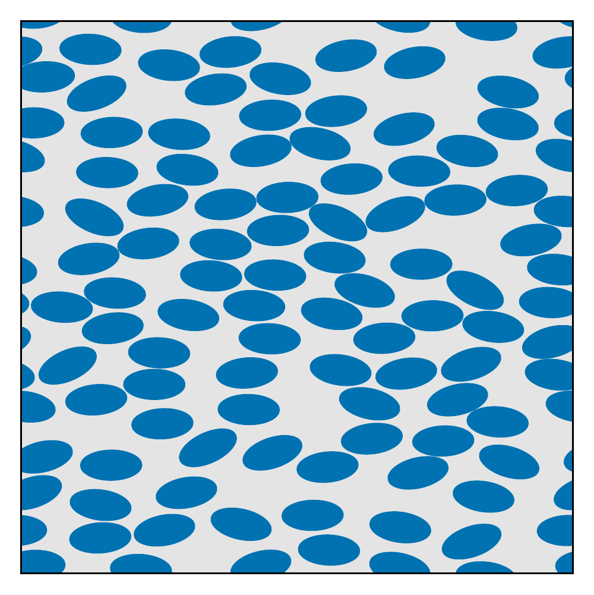
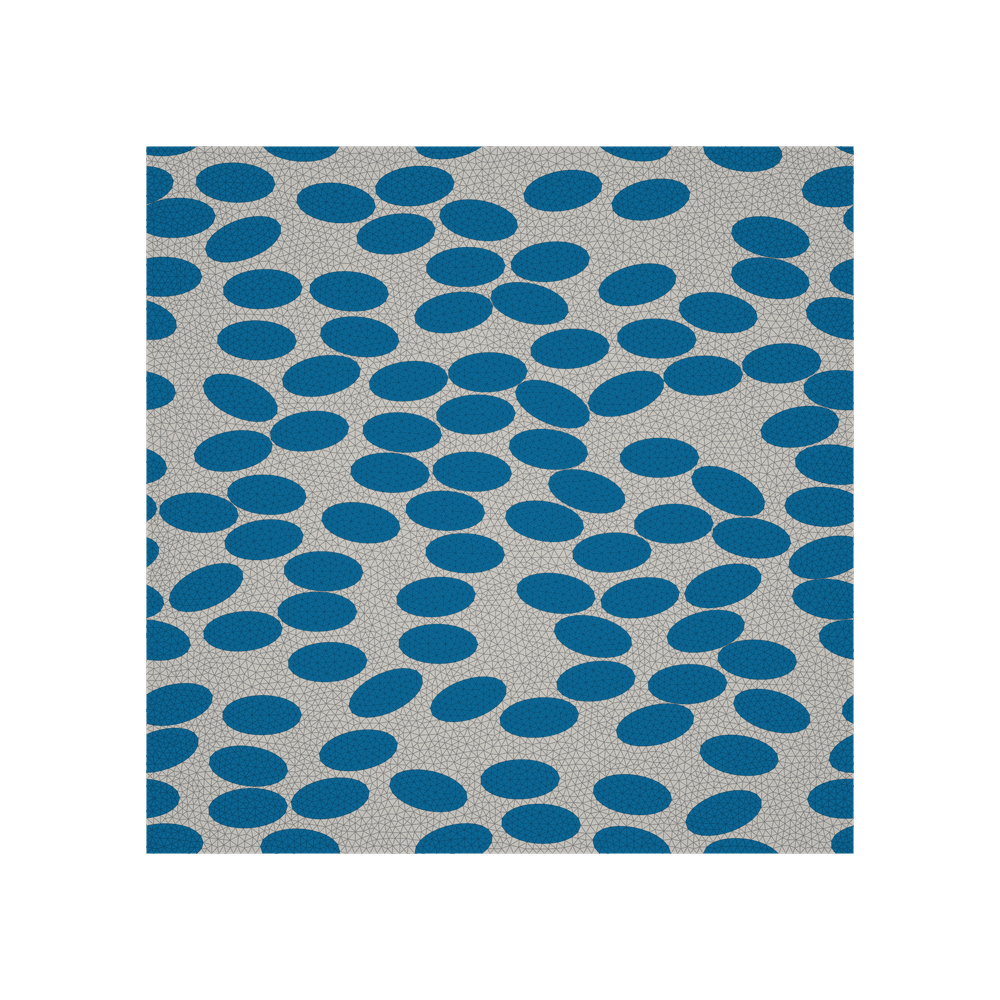
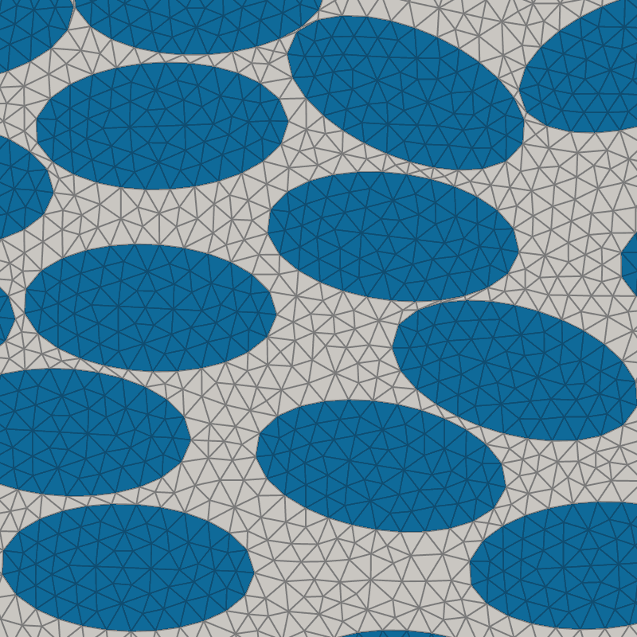

.. _example_MD_Ellipses:

=================================
MD Ellipses
=================================

Input file
==========

To run this example, open a termial inside the ``GMMD`` repository and run the following command:

.. code-block:: console

    geommicgen examples/MD_Ellipses.yaml

In order for you to run any other file of your making, you just need to run the command with the location of your input file.

The full text of the input file is:

.. literalinclude:: ../../../examples/MD_Ellipses.yaml
    :language: yaml

The line ``seed: 1`` fixes the random numbers of the run, so the run gives the microstructure shown at the end of this tutorial.
Without it, every run gives another microstructure.
The inputs of all the tutorials are seeded in the same way.

Phases
======

The microstructure has two phases:

- a matrix phase, described by:

  .. code-block:: yaml

     0: {type: matrix}

- and an ellipse phase, described by:

  .. code-block:: yaml

     1:
       type: ellipse
       n: 100
       vf: 0.5
       angle: {distribution: normal, mean: 0, sigma: 0.2}
       ratio: 2

The microstructure contains 100 ellipses with a volume fraction of 0.5. The ratio between the major and minor axis of the ellipses is 2, and their orientation angle follows a normal distribution with mean 0 and standard deviation 0.2.

Generation Method
=================

This example uses a molecular dynamics simulation to generate the microstructure.

In a nutshell, the molecular dynamics simulation starts by placing all the particles randomly in the simulation box. Then, in each step, it computes the repulsion forces between particles based on their overlap and solves the equations of motion to obtain the particles' velocities. The process continues until a legal configuration is reached, that is, a configuration where there is no overlap.

In each step, the program checks for intersection for every particle pair. This process can be rather time consuming, expecially for a large number of particles, resulting in O(N²) complexity, where N is the number of particles. Thus, speed up schemes were introduced. In a simplified manner, the speed up scheme allows for the program to not check intersection of a pair of particles that can be shown to not intersect apriori, achieving O(N) complexity.
In this example, Verlet speed up scheme is used, with a Verlet factor of 1.1.

The maximum number of iterations is 100.

Mesh
====

The ``meshes`` block asks for one finite element mesh of the microstructure:

.. code-block:: yaml

   meshes:
     gmsh: {elements_per_particle: 5, formats: [abaqus]}

- ``gmsh`` meshes the microstructure with `Gmsh <https://gmsh.info>`_. The mesh is
  conforming, so the element edges follow the boundaries of the ellipses, and periodic,
  so the nodes on opposite sides of the RVE match.
- ``elements_per_particle: 5`` sets the element size so that about 5 elements span the
  smallest ellipse. Here that gives an element size of about 0.011.
- ``element_type`` is not given, so the default, ``tri3``, is used: linear triangles
  with three nodes. In the Abaqus file they are written as ``CPE3`` elements, which are
  plane strain triangles.
- ``formats: [abaqus]`` asks for an Abaqus input file. Other formats can be chosen
  instead, and several can be asked for at once, for example
  ``formats: [abaqus, links, xdmf]``. The list replaces the default format of ``gmsh``,
  which is ``links``. The formats available, and the solvers that read them, are listed
  in the "Formats" section of :doc:`../../input_file/mesh_options`.

Output files
============

After running the command, a folder named ``MD_Ellipses`` is created in the same
directory as the input file. It holds:

.. code-block:: text

   MD_Ellipses/
   ├── MD_Ellipses.yaml                     copy of the input file
   └── mic_0/                               the first (and here only) sample
       ├── mic.json                         microstructure file
       ├── status                           status of the generation
       ├── md_state.npz                     histories of the simulation
       ├── mic.screen                       log of the run
       ├── final_config.pdf                 picture of the microstructure
       └── meshes/
           ├── MD_Ellipses_tri3_epp5.vtu         the mesh, to view
           ├── MD_Ellipses_tri3_epp5.mesh.json   what the .vtu file cannot hold
           └── MD_Ellipses_tri3_epp5.inp         the mesh, for Abaqus

The microstructure
------------------

- ``mic.json`` describes the microstructure: the dimensions of the RVE, the phases,
  and every particle with what defines its geometry. Any program that reads JSON can use
  it, and it is the starting point for meshing the same microstructure again, in other
  ways, with ``geommicgen-mesh``, or for analysing it with ``geommicgen-analyze``.
- ``status`` sums up the run: how long it took, the final overlap between particles,
  whether the generation succeeded, and whether each mesh was made.
- ``md_state.npz`` holds the histories of the molecular dynamics simulation.
- ``mic.screen`` holds everything the run printed to the terminal.
- ``final_config.pdf`` is a picture of the final microstructure, written because the
  input asks for ``final_config: true``:

    Final configuration of the microstructure.

The mesh
--------

The files in ``meshes/`` are named after the input file, the element type and the
number of elements per particle: ``MD_Ellipses_tri3_epp5``.

- ``MD_Ellipses_tri3_epp5.vtu`` is the mesh as a VTK file, with the phase of every
  element stored in a cell array named ``phase``. It is always written, whatever
  ``formats`` asks for. To look at it, open it in `ParaView <https://www.paraview.org>`_,
  click **Apply**, colour it by ``phase``, and set the representation to
  **Surface With Edges** to see the elements.
- ``MD_Ellipses_tri3_epp5.mesh.json`` holds what the VTK file cannot: the dimensions of
  the RVE, whether the mesh is periodic, the names of the phases and how the mesh was
  made. Keep it beside the ``.vtu`` file. With it, ``geommicgen-translate`` can write the
  mesh in other formats later without running the simulation and meshing again, for example
  ``geommicgen-translate MD_Ellipses_tri3_epp5.vtu --to links,xdmf``.
- ``MD_Ellipses_tri3_epp5.inp`` is an Abaqus input file. It holds:

  - the nodes and the ``CPE3`` elements, with one element set per phase (``PHASE_0`` for
    the matrix and ``PHASE_1`` for the ellipses);
  - node sets for the faces and corners of the RVE;
  - the equations that make the RVE periodic.

  The materials and the loading step are placeholders, marked ``TODO`` in the file, so
  that the file runs as written. Replace them with the real properties and loading
  before using the results.

    Mesh of the microstructure: the ellipses in blue, the matrix in grey.

    Close-up of the mesh, where the triangles can be seen. The element edges follow
    the boundaries of the ellipses.

The images of the mesh were made from the ``.vtu`` file with
``docs/images/src/render_mesh.py``, which runs with ParaView's ``pvbatch``:

.. code-block:: console

    pvbatch docs/images/src/render_mesh.py \
        examples/MD_Ellipses/mic_0/meshes/MD_Ellipses_tri3_epp5.vtu mesh.png \
        --dim 2 --size 4000 --edge-shade 0.55

For this example, the mesh has 11 740 nodes and 23 078 elements.

.. include:: ../../_includes/next_button.inc
