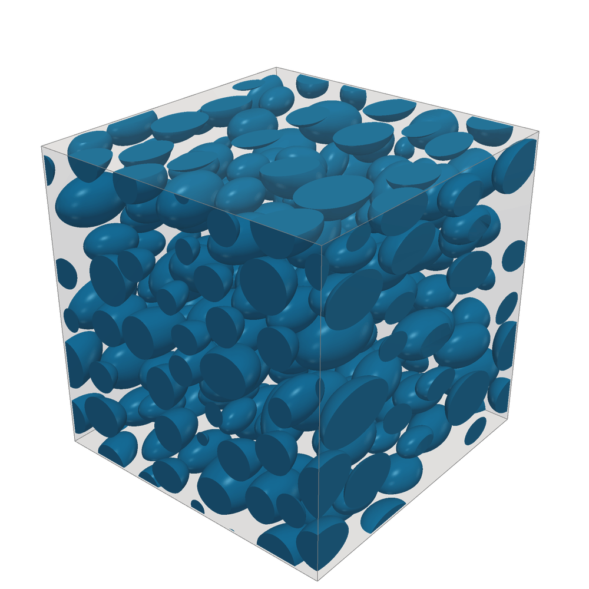
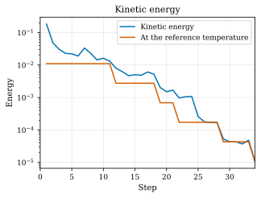
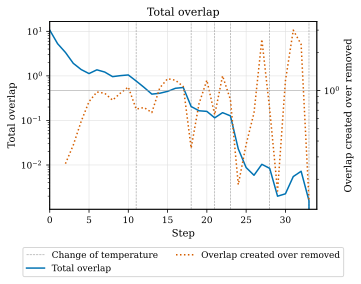
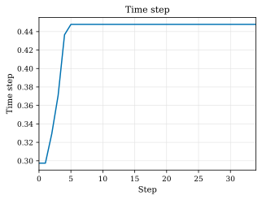

=============
MD Ellipsoids
=============

Input file
==========

The file for this tutorial is named ``MD_Ellipsoids.yaml``. The input file can be run by executing the following command in a terminal console window:

.. code-block:: console

    geommicgen examples/MD_Ellipsoids.yaml

Replacing with the path to the input file according to the location of the GMMD repository in your computer.

The full text of the input file is:

.. literalinclude:: ../../../examples/MD_Ellipsoids.yaml
    :language: yaml

Phases
======

The microstructure has two phases:

- a matrix phase, described by:

  .. code-block:: yaml

     0: {type: matrix}

- and an ellipsoid phase, described by:

  .. code-block:: yaml

     1:
       type: ellipsoid
       vf: 0.3
       axis_1: {distribution: normal, mean: 0.2, sigma: 0.04}
       ratio_12: {distribution: normal, mean: 1.7, sigma: 0.1}
       ratio_13: {distribution: normal, mean: 1.7, sigma: 0.1}
       rot_axis_comp_x: 0
       rot_axis_comp_y: {distribution: uniform, low: -1, high: 1}
       rot_axis_comp_z: {distribution: uniform, low: -1, high: 1}
       angle: {distribution: normal, mean: 0.1, sigma: 0.2}

The microstructure is generated in a cubic RVE of unit dimensions and contains ellipsoids with a volume fraction of 0.3. The principal axis ``axis_1`` follows a normal distribution with mean 0.2 and standard deviation 0.04, and the ratios between this axis and the other two principal axes (``ratio_12`` and ``ratio_13``) both follow a normal distribution with mean 1.7 and standard deviation 0.1, so that, on average, the ellipsoids are elongated along their first principal axis.
The orientation of each ellipsoid is defined by a rotation axis and a rotation angle. The x-component of the rotation axis is fixed at 0, while its y- and z-components follow a uniform distribution between -1 and 1. The rotation angle follows a normal distribution with mean 0.1 and standard deviation 0.2.

Generation Method
=================

This example uses a molecular dynamics simulation to generate the microstructure. The maximum number of iterations is 200 and the speed up scheme used is Verlet, with a Verlet factor of 1.1. A minimum distance of 0.002 between particles is imposed.

Output files
============
After running the command, a folder named ``MD_Ellipsoids`` will be created in the same directory as the input file. This folder contains all the output data related to the microstructure generation.
A .vtk file of the final microstructure is created with ``final_config: true`` under ``analyses`` in the input file. This file can be opened in a 3D visualization tool, such as ParaView.

Since ``motion: true`` is set under ``analyses`` in the input file, GMMD also plots how the molecular dynamics simulation went.
At every step, it records the kinetic energy of the particles, the total overlap between them and the time step.
In this run, the 173 ellipsoids are separated in 34 steps.

The kinetic energy is plotted with the kinetic energy of the particles at the reference temperature of the thermostat, which the thermostat drives it towards.
The thermostat lowers its temperature in steps, and the kinetic energy follows each drop.

The total overlap sums the overlaps of all the pairs of particles.
It falls from about 10 to 0 as the particles move apart.
The plot marks the steps at which the temperature changed, and shows on a second axis the ratio of the overlap created to the overlap removed in each step.

The time step is adaptive: it is smaller when each particle touches more than one other on average.
It starts at 0.30, while the randomly placed ellipsoids overlap many others, and reaches 0.45 within five steps, as the mean number of contacts per particle falls to one.

    Final configuration of the microstructure.

   Kinetic energy history

   Total overlap history

    Time step history.

.. include:: ../../_includes/previous_button.inc
    
.. include:: ../../_includes/next_button.inc