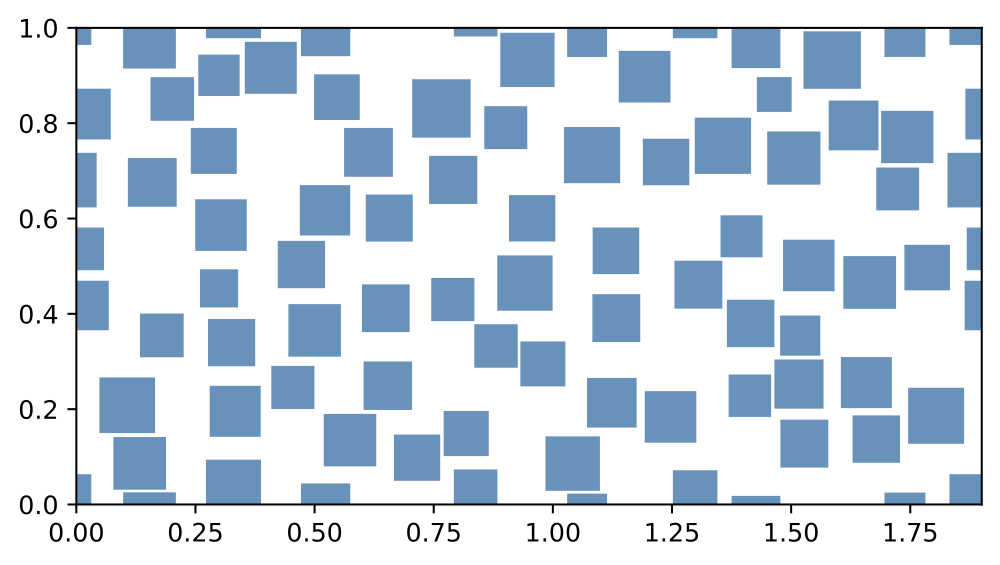
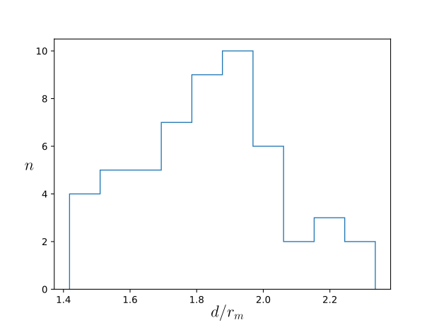
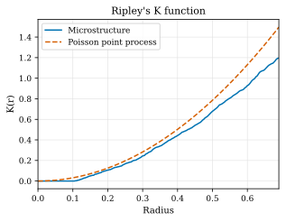
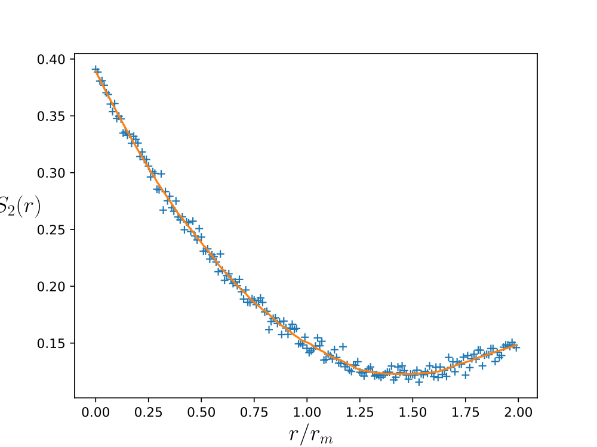

===============================================
RSA Squares with statistical analysis
===============================================

Input file
==========

The file for this tutorial is named ``RSA_Squares.yaml``. The input file can be run by executing the following command in a terminal console window:

.. code-block:: console

    geommicgen examples/RSA_Squares.yaml

Replacing with the path to the input file according to the location of the GMMD repository in your computer.

The full text of the input file is:

.. literalinclude:: ../../../examples/RSA_Squares.yaml
    :language: yaml

Phases
======

The microstructure has two phases:

- a matrix phase, described by:

  .. code-block:: yaml

     0: {type: matrix}

- and a square phase, described by:

  .. code-block:: yaml

     2:
       type: square
       vf: 0.4
       side: {distribution: normal, mean: 0.1, sigma: 0.01}

In this example, the RVE has dimensions [1.9, 1.0].

Generation Method
=================

This example uses a Random Sequential Adsorption simulation to generate the microstructure. The maximum number of iterations is 10000, the speed up scheme used is Cell and a minimum distance of 0.005 between particles is imposed.

Output files
============
After running the command, a folder named ``RSA_Squares`` will be created in the same directory as the input file. This folder contains all the output data related to the microstructure generation.
A .pdf file of the final microstructure is created with ``final_config: true`` under ``analyses`` in the input file. Moreover, some statistical analysis tools are used: Ripley's K function, the nearest neighbor distance distribution and the two-point correlation function of the microstructure are computed and plotted.

    Final configuration of the microstructure.

Nearest neighbor
----------------

    Nearest neighbor distance distribution of the microstructure.

This plot shows the distribution of nearest-neighbour distances between particles. For each particle, d is the distance between its centre and the centre of its nearest neighbour. The x-axis shows d normalised by the mean particle radius, :math:`d/r_m`
. Because these distances vary continuously, they are grouped into 10 equal-width bins. The y-axis shows n, the number of particles whose normalised distance falls in each bin.

Ripley's K-function
-------------------

    Ripley's K-function of the microstructure.

Ripley's K-function measures how many neighbours a particle has within a distance :math:`t`. Imagine drawing a circle of radius :math:`t` around the centre of a particle and counting the other particle centres inside it. This count is averaged over all the particles and divided by the number of particles per unit area, so that the result does not depend on how many particles there are.

.. math::

   \hat{K}(t) = \frac{A}{N^2} \sum_{i} \sum_{j \neq i} \frac{I(d_{ij} \le t)}{w(l_i, l_j)}

where :math:`A` is the area of the domain, :math:`N` is the number of particles, :math:`d_{ij}` is the distance between the centres of particles :math:`i` and :math:`j`, and :math:`I(d_{ij} \le t)` is 1 if :math:`d_{ij} \le t` and 0 otherwise. The weight :math:`w(l_i, l_j)` is an edge correction: it is the fraction of the circle centred at particle :math:`i` and passing through particle :math:`j` that lies inside the domain, and it is 1 when the whole circle is inside.

For particles placed completely at random, the K-function is :math:`K(t) = \pi t^2`. This is the reference curve (orange), which is compared with the K-function computed for the microstructure (blue):

- if the computed curve is **above** the reference, particles have more neighbours than in a random arrangement, so they are **clustered**;
- if it is **below** the reference, particles have fewer neighbours than in a random arrangement, so they are **spread more regularly**;
- if it is **zero** up to a certain distance, no two particle centres are closer than that distance.

In this example, the K-function is zero up to about :math:`t = 0.1`, since the particles cannot overlap and their centres are at least about one particle diameter apart. For larger distances, the computed curve stays below the reference: the particles are spread slightly more regularly than in a random arrangement, and there is no clustering. The K-function can therefore be used to check whether a generated microstructure is clustered, random or regular, and to compare it with the K-function of a real material.

Two-point correlation function
------------------------------

    Two-point correlation function of the microstructure.

The two point correlation function, :math:`S_2(r)`, is the probability that two points a distance :math:`r` apart both lie in the particle phase. It is estimated by randomly placing point pairs in the RVE and is plotted against :math:`r/r_m`, where :math:`r_m` is the mean particle radius. At :math:`r = 0` it equals the particle volume fraction :math:`\phi`, and for large :math:`r` it tends to :math:`\phi^2`. Currently only available for 2D microstructures.

.. include:: ../../_includes/previous_button.inc
    
.. include:: ../../_includes/next_button.inc